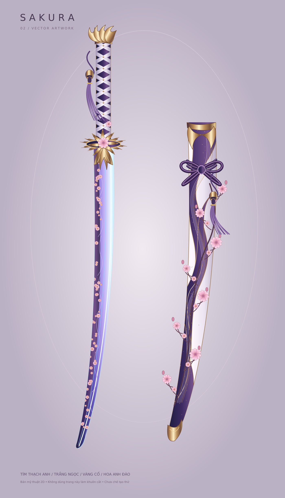

# Sakura — bản thiết kế sửa lần 2

Bản trước giản lược quá mức so với ảnh tham khảo. Phiên bản này làm lại phần mỹ thuật với chuôi quấn hình thoi, chi tiết vàng nhiều lớp, vỏ trắng tím uốn và cành hoa anh đào.

## Tải bản mới

- [ZIP bản mỹ thuật 02](https://github.com/xuanthao260604-sys/adobe/raw/refs/heads/main/Sakura_v2_my_thuat.zip)
- [SVG chỉnh sửa](phien-ban-02/Sakura_v2_my_thuat.svg)
- [PDF vector](phien-ban-02/Sakura_v2_my_thuat.pdf)
- [Ghi chú phiên bản](phien-ban-02/README.md)

Đây là bản mỹ thuật 2D. Các họa tiết mới chưa được chuyển thành khuôn cắt; không dùng trang trình bày làm mẫu cắt.

## Bản 01 được giữ để đối chiếu

- [Bộ khuôn cắt cũ](thiet-ke-sakura/)
- [Hướng dẫn vật liệu và mối nối cũ](thiet-ke-sakura/HUONG_DAN.md)

Chưa chế tạo thử hoặc xác nhận độ khít vật liệu thực tế.
