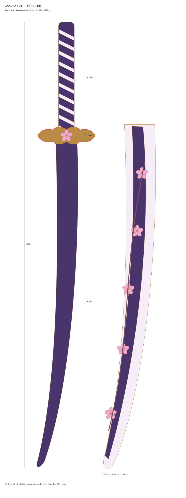

# Bộ thiết kế mô hình Sakura

Bản thiết kế mô hình trang trí EVA dài 1.000 mm, lấy cảm hứng từ ảnh tham khảo tím–trắng–vàng và hoa anh đào.

## Tải file

- [Tải bộ thiết kế ZIP](https://github.com/xuanthao260604-sys/adobe/raw/refs/heads/main/Sakura_bo_thiet_ke.zip)
- [PDF vector 5 trang](thiet-ke-sakura/Sakura_5_trang_vector.pdf)
- [PDF in ghép A4 — 27 trang](thiet-ke-sakura/Mau_cat_ghep_A4_100pct.pdf)
- [Hướng dẫn sử dụng](thiet-ke-sakura/HUONG_DAN.md)
- [Các file SVG, PDF và PNG](thiet-ke-sakura/)

In mẫu ở 100%, kiểm tra ô chuẩn 100 mm và thử mối nối bằng phế liệu trước khi làm toàn bộ. Đã kiểm tra file số; chưa chế tạo thử hoặc kiểm tra trực tiếp bằng Adobe Illustrator. Vỏ trang trí kín, không dùng để tra kiếm.
