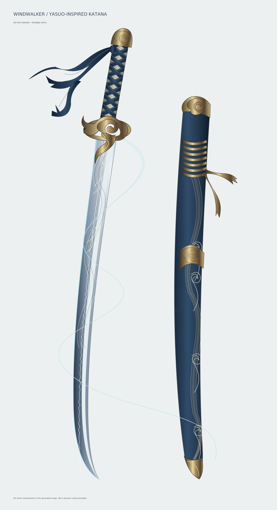
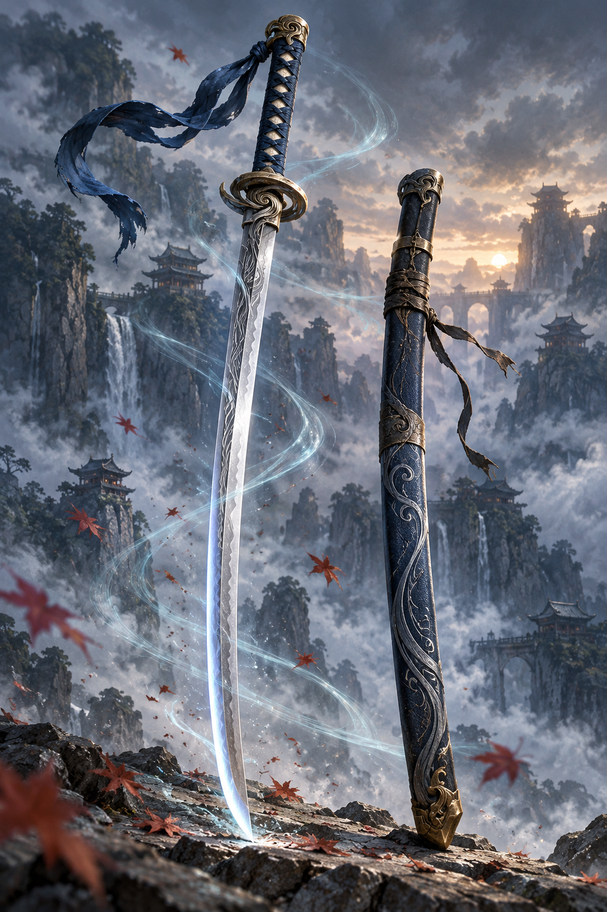

# Katana lấy cảm hứng Yasuo

## Bộ vector chỉnh sửa trong Illustrator

- [Tải ZIP gồm bản lắp, bản bóc tách và 13 nhóm SVG rời](https://github.com/xuanthao260604-sys/adobe/raw/refs/heads/main/katana-yasuo/Yasuo_vector_Illustrator.zip)
- [SVG tổng thể](vector/Yasuo_vector_tong_the.svg)
- [SVG bóc tách](vector/Yasuo_boc_tach.svg)
- [Hướng dẫn Illustrator và giới hạn](vector/README.md)

## Ảnh nguồn đã tạo

